# WBS / EDT — ITERA (jerarquía específica)

Nodos alineados al **Capítulo 2** (alcance y E01–E19) y al **Entregable 1** (§11 requisitos), sin usar etiquetas genéricas del tipo “Disciplina A / Entregable / Actividad”.

> **Regla de redacción:** entregable = **sustantivo** · actividad = **verbo** en infinitivo.  
> **Regla de dueño:** cada E0x aparece una sola vez.  
> **Conflicto de alcance:** si el Entregable 1 pide algo que el Capítulo 2 excluye (reservas, hospedaje gestionado, clima en tiempo real, cobros, GPS paso a paso), **no** entra como nodo de esta WBS.

---

## Objetivos (referencia)

| # | Objetivo específico (resumen) | Entregables |
|---|-------------------------------|-------------|
| OE1 | Catálogo georreferenciado Pereira/Risaralda, 5 categorías, ingesta APIs/IA | E01 |
| OE2 | Recomendación por perfiles, agrupamiento y similitud; evaluación vs. baseline | E03–E05 |
| OE3 | Prototipo web + móvil + API: mapa, filtros, favoritos, itinerarios | E02, E07–E15 |
| OE4 | Fuente, verificación, confianza; IA solo apoyo; recomendaciones explicables | E09 (+ 1.2) |
| OE5 | Validar Free / Pro / Pro anual con X usuarios (sin pasarela de pagos) | E16 |
| OE6 | KPI: reducir dispersión centralizando oferta consultable (vía E01 + apps) | E01, E13, E14 |
| OE7 | Usabilidad: ≥ N usuarios; ≥ X % tareas críticas (buscar, filtrar, ficha, guardar, itinerario) en web y/o móvil | E13, E14, E18 |
| OE8 | Privacidad/condiciones publicadas; aceptación registrada en el 100 % de altas | E17 |
| OE9 | Chatbot solo con catálogo + enlace a fichas; ≥ M % respuestas útiles en prueba controlada | E06, E09 (+ OE4) |
| OE10 | Consistencia web ↔ móvil (misma API): usuario, favoritos e itinerarios en ≥ P % de pruebas de integración | E11, E12, E15, E18 |
| OE11 | Prototipo desplegable + docs de instalación/API; un tercero lo levanta en ≤ T horas | E19 |

> **Umbrales a fijar:** N, X %, M %, P %, T (junto con X de OE5 / `1.5.1.3`).

---

## Diagrama WBS (nodos específicos)

```mermaid
flowchart TB
  P["1. ITERA — Prototipo funcional<br/>descubrimiento y planificación contextual<br/>Eje Cafetero / Pereira y municipios cercanos"]

  P --> C1
  P --> C2
  P --> C3
  P --> C4
  P --> C5

  subgraph C1["1.1 Catálogo georreferenciado — OE1 + OE6"]
    direction TB
    C11["1.1.1 Catálogo de 150–300 actividades<br/>Pereira y municipios cercanos — E01"]
    C11 --> C111["Recopilar actividades vía APIs e IA de búsqueda"]
    C11 --> C112["Clasificar en naturaleza, cultura, gastronomía,<br/>deporte y recreación, y eventos"]
    C11 --> C113["Registrar ubicación, fecha, costo,<br/>organizador y atributos de ficha"]
    C11 --> C114["Georreferenciar cada actividad<br/>para mapa y filtro por distancia"]
  end

  subgraph C2["1.2 Trazabilidad y confiabilidad — OE4"]
    direction TB
    C21["1.2.1 Campos de procedencia en el catálogo"]
    C21 --> C211["Identificar fuente verificable por actividad"]
    C21 --> C212["Registrar fecha de verificación / actualización"]
    C21 --> C213["Asignar nivel de confianza"]
    C22["1.2.2 Reglas de uso de IA"]
    C22 --> C221["Limitar IA generativa a herramienta de apoyo"]
    C22 --> C222["Prohibir reseñas inventadas y agentes autónomos permanentes"]
    C22 --> C223["Exigir explicación de por qué se recomienda"]
  end

  subgraph C3["1.3 Recomendación personalizada — OE2 + OE9"]
    direction TB
    C31["1.3.1 Perfil de usuario — E03"]
    C31 --> C311["Capturar intereses, experiencia y dificultad preferida"]
    C31 --> C312["Permitir consultar y modificar el perfil"]
    C32["1.3.2 Preferencias de contenido — E04"]
    C32 --> C321["Configurar categorías e intereses"]
    C32 --> C322["Aplicar preferencias al catálogo y al ranking"]
    C33["1.3.3 Motor de afinidad y similitud — E05"]
    C33 --> C331["Calcular afinidad con intereses e historial"]
    C33 --> C332["Usar guardados, reseñas e interacciones del chatbot"]
    C33 --> C333["Incorporar distancia, presupuesto y disponibilidad"]
    C33 --> C334["Agrupar usuarios similares"]
    C33 --> C335["Evaluar precisión frente a modelo de referencia"]
    C34["1.3.4 Chatbot de recomendaciones — E06 / OE9"]
    C34 --> C341["Responder con actividades existentes del catálogo"]
    C34 --> C342["Enlazar respuestas a fichas E09"]
    C34 --> C343["Apoyar descubrimiento proactivo<br/>eventos nuevos, cercanos, por fecha"]
    C34 --> C344["Medir % respuestas útiles en prueba controlada"]
  end

  subgraph C4["1.4 Aplicaciones y exploración — OE3 + OE8 + OE10"]
    direction TB
    C41["1.4.1 Autenticación — E02"]
    C41 --> C411["Registrar, iniciar, cerrar sesión y recuperar acceso"]
    C42["1.4.2 API y base de datos compartida — E15 / OE10"]
    C42 --> C421["Centralizar usuarios, actividades, interacciones,<br/>comentarios, itinerarios y recomendaciones"]
    C42 --> C422["Garantizar consistencia web ↔ móvil"]
    C43["1.4.3 Mapa interactivo — E07"]
    C43 --> C431["Mostrar marcadores georreferenciados"]
    C43 --> C432["Abrir ficha desde el marcador"]
    C44["1.4.4 Búsqueda y filtros — E08"]
    C44 --> C441["Filtrar por ubicación, fecha y categoría"]
    C44 --> C442["Filtrar por distancia, dificultad y preferencias"]
    C45["1.4.5 Ficha de actividad — E09"]
    C45 --> C451["Mostrar descripción, ubicación, fechas y costo"]
    C45 --> C452["Mostrar fuente, fecha de verificación y confianza"]
    C46["1.4.6 Comentarios — E10"]
    C46 --> C461["Publicar y consultar comentarios autenticados"]
    C46 --> C462["Moderar / retirar contenido inapropiado"]
    C47["1.4.7 Guardados y favoritos — E11 / OE10"]
    C47 --> C471["Marcar actividades y conservarlas por cuenta"]
    C48["1.4.8 Itinerario básico — E12 / OE10"]
    C48 --> C481["Añadir, ordenar, quitar y visualizar actividades"]
    C48 --> C482["Excluir reserva y pago del flujo"]
    C49["1.4.9 Aplicación web — E13 / OE7"]
    C49 --> C491["Integrar auth, catálogo, mapa, recomendaciones,<br/>perfiles, comentarios e itinerarios"]
    C4A["1.4.10 Aplicación móvil — E14 / OE7"]
    C4A --> C4A1["Operar flujos principales en dispositivo real"]
    C4B["1.4.11 Privacidad y condiciones — E17 / OE8"]
    C4B --> C4B1["Publicar textos y registrar aceptación en el alta"]
  end

  subgraph C5["1.5 Negocio, calidad y cierre — OE5 + OE7 + OE10 + OE11"]
    direction TB
    C51["1.5.1 Planes Free, Pro y Pro anual — E16"]
    C51 --> C511["Definir y visualizar características por plan"]
    C51 --> C512["Habilitar funciones según plan asignado<br/>sin integrar cobros dentro de ITERA"]
    C51 --> C513["Validar disposición a pagar con X usuarios de prueba"]
    C52["1.5.2 Validación y pruebas — E18 / OE7 / OE10"]
    C52 --> C521["Probar flujos críticos web-móvil"]
    C52 --> C522["Probar seguridad básica y usabilidad<br/>tareas críticas OE7"]
    C52 --> C523["Medir calidad de recomendaciones y consumo de IA"]
    C52 --> C524["Verificar consistencia favoritos/itinerarios web-móvil"]
    C53["1.5.3 Despliegue y documentación — E19 / OE11"]
    C53 --> C531["Preparar versiones y ambientes desplegables"]
    C53 --> C532["Documentar instalación y API<br/>meta: tercero en ≤ T horas"]
  end
```



---

## Árbol WBS completo (para editar / entregar)

```
1. ITERA — Prototipo funcional de descubrimiento y planificación contextual
│     Cobertura: Eje Cafetero · foco operativo Pereira y municipios cercanos (Risaralda)
│
├── 1.1 Catálogo georreferenciado                                          ← OE1 / OE6
│   └── 1.1.1 Catálogo de 150–300 actividades                               (E01)
│       ├── 1.1.1.1 Recopilar actividades y eventos vía APIs e IA de búsqueda
│       ├── 1.1.1.2 Clasificar en naturaleza, cultura, gastronomía,
│       │            deporte y recreación, y eventos
│       ├── 1.1.1.3 Registrar ubicación, fecha, costo, organizador
│       │            y datos de ficha (descripción, requisitos, público)
│       ├── 1.1.1.4 Georreferenciar actividades para mapa y distancia
│       └── 1.1.1.5 Validar campos obligatorios de cada registro
│
├── 1.2 Trazabilidad y confiabilidad de la información                     ← OE4
│   ├── 1.2.1 Campos de procedencia del catálogo / ficha
│   │   ├── 1.2.1.1 Identificar fuente verificable
│   │   ├── 1.2.1.2 Registrar fecha de verificación o actualización
│   │   └── 1.2.1.3 Asignar nivel de confianza
│   └── 1.2.2 Gobernanza de inteligencia artificial
│       ├── 1.2.2.1 Limitar IA generativa a apoyo (no fuente primaria)
│       ├── 1.2.2.2 Impedir reseñas inventadas y agentes autónomos permanentes
│       └── 1.2.2.3 Exigir explicación de la recomendación mostrada
│
├── 1.3 Recomendación personalizada                                        ← OE2 / OE9
│   ├── 1.3.1 Perfil de usuario                                             (E03)
│   │   ├── 1.3.1.1 Capturar intereses, nivel de experiencia
│   │   │            y preferencia de dificultad
│   │   └── 1.3.1.2 Permitir consultar y modificar el perfil
│   ├── 1.3.2 Preferencias de contenido                                     (E04)
│   │   ├── 1.3.2.1 Configurar categorías e intereses de contenido
│   │   └── 1.3.2.2 Persistir preferencias que alteren catálogo y ranking
│   ├── 1.3.3 Motor de afinidad, agrupamiento y similitud                   (E05)
│   │   ├── 1.3.3.1 Calcular afinidad perfil ↔ actividad
│   │   ├── 1.3.3.2 Incorporar historial, lugares visitados/guardados,
│   │   │            reseñas e interacciones del chatbot
│   │   ├── 1.3.3.3 Incorporar distancia, presupuesto y disponibilidad
│   │   ├── 1.3.3.4 Agrupar usuarios por similitud de intereses
│   │   ├── 1.3.3.5 Generar explicación de por qué se sugiere cada ítem
│   │   └── 1.3.3.6 Evaluar precisión frente a un modelo de referencia
│   └── 1.3.4 Chatbot de recomendaciones                                    (E06 / OE9)
│       ├── 1.3.4.1 Responder consultas solo con actividades del catálogo
│       ├── 1.3.4.2 Referenciar fichas de actividad (E09)
│       ├── 1.3.4.3 Apoyar descubrimiento proactivo
│       │             (eventos nuevos, cercanos, por fecha, similares)
│       └── 1.3.4.4 Medir porcentaje de respuestas útiles (meta ≥ M %)
│
├── 1.4 Aplicaciones y exploración                                         ← OE3 / OE8 / OE10
│   ├── 1.4.1 Servicio de autenticación                                     (E02)
│   │   └── 1.4.1.1 Registrar, iniciar, cerrar sesión y recuperar acceso
│   ├── 1.4.2 API y persistencia compartida                                 (E15 / OE10)
│   │   ├── 1.4.2.1 Modelar usuarios, actividades, interacciones,
│   │   │            comentarios, itinerarios y recomendaciones
│   │   └── 1.4.2.2 Mantener consistencia entre web y móvil
│   ├── 1.4.3 Mapa interactivo                                              (E07)
│   │   ├── 1.4.3.1 Visualizar marcadores georreferenciados
│   │   └── 1.4.3.2 Abrir detalle/ficha desde el marcador
│   ├── 1.4.4 Búsqueda y filtros                                            (E08)
│   │   ├── 1.4.4.1 Filtrar por ubicación, fecha y categoría
│   │   └── 1.4.4.2 Filtrar por distancia, dificultad y preferencias
│   ├── 1.4.5 Ficha de actividad                                            (E09)
│   │   ├── 1.4.5.1 Presentar descripción, ubicación, fechas,
│   │   │            costo aproximado y organizador
│   │   └── 1.4.5.2 Presentar fuente, fecha de verificación
│   │                 y nivel de confianza
│   ├── 1.4.6 Comentarios de actividades                                    (E10)
│   │   ├── 1.4.6.1 Publicar y listar comentarios de usuarios autenticados
│   │   └── 1.4.6.2 Retirar contenidos inapropiados (moderación básica)
│   ├── 1.4.7 Guardados y favoritos                                         (E11 / OE10)
│   │   └── 1.4.7.1 Marcar actividades y consultarlas por cuenta
│   ├── 1.4.8 Itinerario básico                                             (E12 / OE10)
│   │   ├── 1.4.8.1 Añadir, ordenar, quitar y visualizar actividades
│   │   └── 1.4.8.2 Mantener el flujo sin reserva ni pago
│   ├── 1.4.9 Aplicación web                                                (E13 / OE7)
│   │   └── 1.4.9.1 Integrar auth, catálogo, mapa, recomendaciones,
│   │                 perfiles, comentarios e itinerarios en navegador
│   ├── 1.4.10 Aplicación móvil                                             (E14 / OE7)
│   │   └── 1.4.10.1 Operar flujos principales en al menos un dispositivo real
│   └── 1.4.11 Privacidad y condiciones de uso                              (E17 / OE8)
│       └── 1.4.11.1 Publicar políticas y registrar aceptación en el registro
│
└── 1.5 Negocio, calidad y cierre                                          ← OE5 / OE7 / OE10 / OE11
    ├── 1.5.1 Planes Free, Pro mensual y Pro anual                          (E16)
    │   ├── 1.5.1.1 Definir y visualizar características de cada plan
    │   ├── 1.5.1.2 Habilitar funcionalidades según plan asignado
    │   │            (sin pasarela de cobros dentro de ITERA)
    │   └── 1.5.1.3 Validar disposición a pagar con X usuarios de prueba
    ├── 1.5.2 Validación y pruebas del producto                             (E18 / OE7 / OE10)
    │   ├── 1.5.2.1 Ejecutar pruebas de flujos críticos e integración web-móvil
    │   ├── 1.5.2.2 Ejecutar pruebas de seguridad básica y usabilidad
    │   │            (tareas críticas OE7: buscar, filtrar, ficha, guardar, itinerario)
    │   ├── 1.5.2.3 Medir calidad de recomendaciones y consumo de IA
    │   └── 1.5.2.4 Verificar consistencia de favoritos e itinerarios web ↔ móvil
    └── 1.5.3 Despliegue y documentación técnica                            (E19 / OE11)
        ├── 1.5.3.1 Preparar versiones y configuración de ambientes
        └── 1.5.3.2 Documentar instalación y contrato de la API
                      (meta OE11: tercero en ≤ T horas)
```

---

## Fuera de esta WBS (Capítulo 2 — qué no incluye)

No se crean nodos para: reservas/tiquetes, hospedaje u órdenes en restaurantes, marketplace, chat privado, red social completa, GPS paso a paso, cobertura nacional, clima en tiempo real, predicción de riesgos, reseñas inventadas por IA, agentes autónomos permanentes, optimización avanzada de rutas, publicidad que altere el ranking orgánico, **ni cobros reales** (solo visualización/reglas de planes).

---

## Criterios de aceptación ancla (por entregable clave)

| Código | Criterio del Capítulo 2 |
|--------|-------------------------|
| E01 | 150–300 registros consultables con campos obligatorios |
| E05 | Devuelve recomendaciones pertinentes y permite medir calidad |
| E07 | Explorar en mapa y abrir detalle |
| E08 | Solo actividades que cumplen filtros |
| E09 | Ficha con datos disponibles y procedencia |
| E13/E14 | Flujos principales en navegador / dispositivo real |
| E15 | Misma API; datos consistentes web-móvil |
| E16 | Tres planes visibles; funciones según plan; sin cobros internos |
| E18 | Pruebas críticas hechas; bloqueantes corregidos; usabilidad OE7; consistencia OE10 |
| E19 | Instalación/despliegue posible con la documentación (OE11: ≤ T h) |
| E06 | Chatbot solo catálogo + fichas; ≥ M % útiles (OE9) |
| E17 | Políticas publicadas; aceptación en 100 % de altas (OE8) |

---

## Próximo paso

1. Fijar umbrales: **X** (OE5 / `1.5.1.3`), **N** y **X %** (OE7), **M %** (OE9), **P %** (OE10), **T** horas (OE11).
2. Asignar responsable y estimación a cada paquete 1.x.x.x (diccionario WBS), incl. `1.3.4.4` y `1.5.2.4`.
3. Marcar dependencias (p. ej. E05 depende de E01+E03+E04; E07/E08/E09 dependen de E01+E15; OE10 depende de E15+E11+E12+E18).
